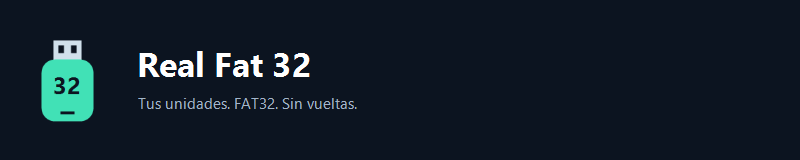

# RealFat32



Aplicación portable y nativa para consultar unidades y formatear volúmenes en FAT32, incluidos los de más de 32 GB. Interfaz en español, inglés y portugués, sin dependencias descargadas, anuncios ni telemetría. Implementación propia en C# y Windows Forms; no incluye ni ejecuta GUIFormat.

**Versión 0.3.0-alpha.1 · Alpha.** Creada por **Fabian Gonzalez Dev · PoligonTek**, publicada bajo licencia MIT. Motor validado con imágenes sintéticas en memoria. Aún requiere pruebas de integración con Windows sobre un VHD y un USB descartable antes de considerarse listo para producción. No se ha realizado ningún formateo de discos físicos durante el desarrollo.

## Uso

1. Abre `dist/RealFat32.exe` en Windows 10/11 de 64 bits con .NET Framework 4.8.
2. Pulsa **Actualizar** y selecciona el volumen. Comprueba letra, modelo, capacidad y número de disco.
3. Configura la etiqueta y el tamaño de clúster; Automático es la opción recomendada.
4. Abre como administrador cuando se solicite, vuelve a seleccionar la unidad y pulsa **Formatear en FAT32**.
5. Revisa el destino en la ventana de confirmación. El botón **Formatear** muestra una cuenta atrás de tres segundos; cuando se habilite, púlsalo para confirmar. Cancelar o cerrar la ventana no formatea nada.
6. Al terminar correctamente aparece una animación de corneta de fiesta, confetis que caen y un OK verde con el mensaje **Disco totalmente formateado**. Sigue siendo un formato rápido, no un borrado seguro.

## Apariencia e idioma

En **Configuración** puedes elegir **Windows (claro)**, que es el aspecto predeterminado con colores y botones del sistema, o **Nocturno**, que conserva el fondo oscuro original. También puedes elegir **Español**, **English** o **Português**; se traducen la interfaz, la confirmación, la celebración y los mensajes propios de progreso y error. Los errores generados directamente por Windows pueden seguir el idioma del sistema.

Los cambios se aplican al guardar sin reiniciar y se conservan en `%LOCALAPPDATA%\RealFat32\settings.txt`. En el primer inicio se usa un fondo gris más claro y **Automático (idioma de Windows)**: español para Windows en español, portugués para Windows en portugués e inglés para los demás idiomas. Puedes elegir manualmente cualquiera de los tres idiomas. Se conservan las selecciones manuales guardadas con versiones anteriores. En modo demostración, **Ver celebración** reproduce la animación con un aviso explícito de que no se formateó ningún disco.

## Actualizaciones y versiones

La app consulta las Releases públicas de https://github.com/poligontek/RealFat32 al iniciar. **Buscar actualizaciones** repite la consulta; el estado aparece en letra pequeña al pie. Si no hay una versión nueva no se abre ningún popup. Los errores de conexión o API se informan en ese estado, sin confundirse con “no hay actualizaciones”.

Cuando existe una versión más reciente, aparece un aviso **Sí / No** con sus notas. Al aceptar, se descarga el ejecutable de esa Release, se comprueba SHA256 y su metadata de producto, empresa y versión, se cierra la app, se reemplaza el archivo y se reinicia. Se conserva `RealFat32.exe.previous` junto al ejecutable. El helper está integrado en el programa y solo se extrae al actualizar; no se requieren scripts externos. La actualización se aplaza mientras haya una operación de disco o un diálogo abierto. Si la carpeta de instalación no permite escritura, se mantiene la versión anterior y se informa del error.

En Configuración se elige el canal **Estable** (predeterminado), **Beta** (incluye RC y estables) o **Alpha** (todos). El orden de versiones es `alpha < beta < rc < estable`; no se instalan versiones iguales o anteriores. Alpha identifica esta compilación todavía en validación. **Acerca de** muestra los créditos, la versión y el historial traducido.

Las Releases deben incluir `RealFat32.exe` y su digest SHA256 de GitHub o `RealFat32.exe.sha256`. Se revisan las 100 Releases más recientes; se omiten borradores, etiquetas incompatibles y assets de otros repositorios. No se incluyen tokens de GitHub: el repositorio y las descargas deben ser públicos. Los hashes verifican integridad sobre HTTPS; la app aún no tiene firma Authenticode.

El workflow `.github/workflows/release.yml` compila y prueba al publicar un tag como `v0.3.0-alpha.1`, verifica que coincida con `src/ReleaseInfo.cs` y crea la Release con ejecutable, checksum y changelog. Los tags Alpha/Beta/RC se marcan como prerelease. Para futuras versiones actualiza también la metadata numérica de `Program.cs`, `app.manifest` y los changelogs.

El formato es rápido: crea tablas FAT, sector de arranque, FSInfo y directorio raíz. **No borra de forma segura los datos antiguos**, no busca sectores defectuosos y no crea una unidad de arranque. No retires la unidad ni cierres Windows durante el proceso.

## Compatibilidad y protecciones

- Particiones existentes con letra en discos básicos MBR/GPT; capacidad de 512 MiB a 2 TiB, sectores lógicos de 512 o 4096 bytes y hasta 4.294.967.295 sectores. Exactamente 2 TiB con sectores de 512 bytes supera ese último límite.
- Clústeres de hasta 32 KiB y al menos 65.525 clústeres. Las combinaciones incompatibles se rechazan antes de escribir.
- El límite por archivo de FAT32 es 4 GiB menos 1 byte. FAT32 no puede admitir cualquier tamaño de disco ni de archivo.
- Se protegen los discos completos que contienen Windows, arranque, paginación o el propio ejecutable. Copia RealFat32 a otro disco si se encuentra en el dispositivo que deseas formatear.
- Se rechazan volúmenes cifrados con BitLocker, de solo lectura, fuera de línea, especiales o con múltiples extensiones. No se ofrecen particiones sin letra ni espacio sin particionar.
- En GPT solo se aceptan particiones de datos básicos. En MBR se aceptan los tipos de datos 06/07/0B/0C/0E y se actualiza el tipo a 0C (FAT32 LBA). No se cambian el inicio ni el tamaño de la partición, ni se crean o borran particiones.
- Se comprueban identidad, GUID de volumen, capacidad, número de disco, extensión y sector antes de escribir. La apertura usa el GUID de volumen. Si Windows no concede bloqueo exclusivo, se aborta.
- No hay formato automático, acceso por línea de comandos para formatear ni cancelación durante las escrituras. Un error de E/S o una desconexión puede dejar el volumen sin formato y requerir repetir la operación.

## Compilar y comprobar

Desde PowerShell, en la carpeta del proyecto:

```powershell
.\build.ps1 -Test
.\dist\RealFat32.exe --demo
.\dist\RealFat32.exe --screenshot .\assets\screenshot.png
.\dist\RealFat32.exe --screenshot .\assets\night-en.png --night --lang=en
.\dist\RealFat32.exe --success-screenshot .\assets\success-pt.png --lang=pt
```

Se utiliza el compilador de .NET Framework incluido en Windows; no se necesita el SDK de .NET ni restaurar paquetes de NuGet. El build genera el icono multirresolución, el banner, el ejecutable y su SHA256. `--demo` muestra una unidad ficticia y desactiva el formato. Las pruebas del motor usan imágenes en memoria; las de interfaz cubren los tres idiomas y ambos temas, persistencia de preferencias, cierre de confirmación y bloqueo del botón antes de tres segundos. Ninguna prueba abre un volumen para formatearlo. Los comandos de captura no guardan cambios en las preferencias.

Los gráficos se generan desde `src/Brand.cs`: pendrive con “32” para el icono y “Real Fat 32” para el banner. `assets/RealFat32.ico` puede usarse también como favicon en la futura web.

La comprobación de integración de solo lectura detectó ocho volúmenes en el equipo de desarrollo y protegió los discos de Windows y de la aplicación. La consulta de BitLocker de otros volúmenes requiere elevación. La revisión por control de ventanas quedó pendiente porque el helper no pudo abrir una ventana targeteable; sí se revisó la captura interna de la interfaz de demostración.

## Validación pendiente antes de publicar

Sobre un VHD descartable y luego un USB sin datos: comprobar detección, elevación UAC, rechazo de volumen en uso, formato desde NTFS/exFAT/FAT32, remontaje y reconocimiento por Windows, `chkdsk`, copia y lectura de archivos, extracción/reconexión y validación de la identidad. Cubrir MBR/GPT, volúmenes mayores de 32 GiB y sectores 512/4096 cuando haya hardware disponible. Repetir también la prueba de protección de los discos del sistema y paginación.

## Referencias técnicas

- [Especificación FAT de Microsoft](https://www.scs.stanford.edu/~zyedidia/docs/_other/fat.pdf).
- [Bloqueo exclusivo de volúmenes](https://learn.microsoft.com/en-us/windows/win32/api/winioctl/ni-winioctl-fsctl_lock_volume).
- [Desmontaje y secuencia para cambiar el sistema de archivos](https://learn.microsoft.com/en-us/windows/win32/api/winioctl/ni-winioctl-fsctl_dismount_volume).
- [Extensiones de disco](https://learn.microsoft.com/en-us/windows/win32/api/winioctl/ns-winioctl-disk_extent).
- [Tipo de partición MBR](https://learn.microsoft.com/en-us/windows-hardware/drivers/ddi/ntdddisk/ns-ntdddisk-_set_partition_information).

Código y Releases: https://github.com/poligontek/RealFat32. La aplicación se organiza en `D:\Trabajos\PoligonTek\RealFat32\App` y la landing en `D:\Trabajos\PoligonTek\Poligontek\RealFat32\Web`. Esta versión no está firmada digitalmente.

## Unified working copy · 2026-11-22

Canonical local repository: `D:\Trabajos\PoligonTek\RealFat32\App`.
Use this folder in GitHub Desktop (File → Add local repository). The Git history and existing local changes were preserved during consolidation.